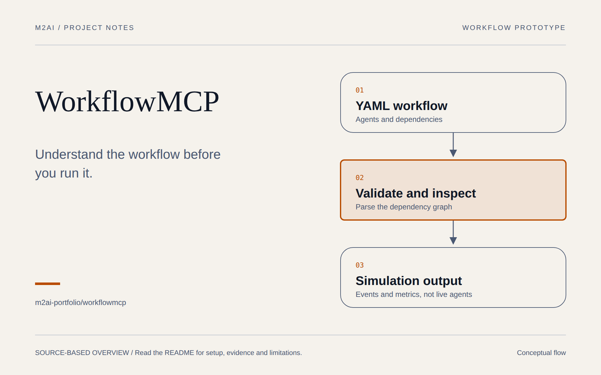

# WorkflowMCP



A research step feeds a summarizer, and the summary needs a review. Before connecting models or paying for a run, you need to know whether those steps form a valid plan. WorkflowMCP turns a small YAML file into an inspectable dependency graph, checks it for mistakes, and lets you explore execution events with a simulator.

**Status:** Python CLI prototype for workflow parsing, validation, visualization, simulated monitoring, and local example skills. The checked-in code does not provide an MCP transport or a live multi-agent execution engine. The project name describes its intended direction.

## What you can do

- Express agents, tools, and zero-based step dependencies in YAML.
- Validate required fields, dependency references, self-dependencies, and cycles.
- Export a JSON graph with nodes, dependents, and an execution order.
- Write a Mermaid diagram, with optional PNG rendering if `mmdc` is installed.
- Produce simulated event logs and Prometheus-formatted text, including a failure scenario.
- Load and call local Python skill examples through the bundled registry.

## Set up

Requires Python 3.11 or newer. The core dependencies are Click and PyYAML. No model account or API key is needed for these local examples.

```bash
git clone https://github.com/m2ai-portfolio/workflowmcp.git
cd workflowmcp
python3 -m venv .venv
source .venv/bin/activate
python -m pip install -e '.[dev]'
```

On Windows, activate the virtual environment with `.venv\Scripts\Activate.ps1` in PowerShell.

## Walk through the example

1. Open [example.yaml](example.yaml). It describes a researcher, summarizer, and reviewer, with each later step depending on the previous one.
2. Validate the plan and inspect the generated graph:

   ```bash
   workflow-mcp validate --file example.yaml
   workflow-mcp parse --file example.yaml
   ```

   Validation should print `Workflow is valid`. Parsing returns `name`, `nodes`, and `execution_order`; the bundled example is named `example-workflow`.

3. Export a diagram for review:

   ```bash
   workflow-mcp visualize --file example.yaml --output workflow.mmd
   ```

4. Explore the simulator's normal and failure paths:

   ```bash
   workflow-mcp monitor --workflow example.yaml --format json
   workflow-mcp monitor --workflow example.yaml --format prometheus
   workflow-mcp monitor --workflow example.yaml --test
   ```

   These commands print simulated events or metrics to standard output. They do not start a metrics server or observe a real agent run.

5. Try a bundled local skill:

   ```bash
   copilot_sdk list_skills
   copilot_sdk run_skill --handle summarizer --input '{"text":"A clear plan makes a workflow easier to review."}'
   ```

   `copilot_sdk` is this project's own command name. The implementation loads Python modules with a `run(input_data)` function; it is not evidence of integration with an external Copilot SDK.

## Validate changes

```bash
python -m pytest
workflow-mcp validate --file bad.yaml
```

The invalid fixture is expected to exit nonzero. Tests cover parsing, agents, monitoring, and the skill registry. Test commands are provided for reproduction, not a claim that the project has passed on your machine.

## Source map

| Path | Purpose |
|---|---|
| [workflow_mcp/cli.py](workflow_mcp/cli.py) | CLI commands and simulator entry point |
| [workflow_mcp/core.py](workflow_mcp/core.py) | Validation, dependency graph, and Mermaid export |
| [workflow_mcp/models/](workflow_mcp/models/) | Workflow and agent data structures |
| [workflow_mcp/monitoring/](workflow_mcp/monitoring/) | Simulated events and metrics |
| [workflow_mcp/sdk/](workflow_mcp/sdk/) | Local skill registry and examples |
| [workflow_mcp/tests/](workflow_mcp/tests/) | Unit tests |

## Boundaries and next steps

There is no `run` command, hosted service, live Claude Code stream integration, or remote Git skill loader in this snapshot. Use it to inspect a workflow contract and study the components before building an executor around it. Local skill modules run as ordinary Python code, so only load code you trust.

Built by Matthew Snow / [M2AI](https://memyselfplusai.com). [MIT license](LICENSE).
